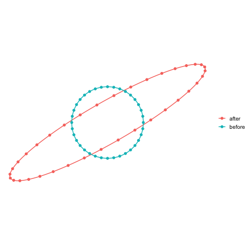
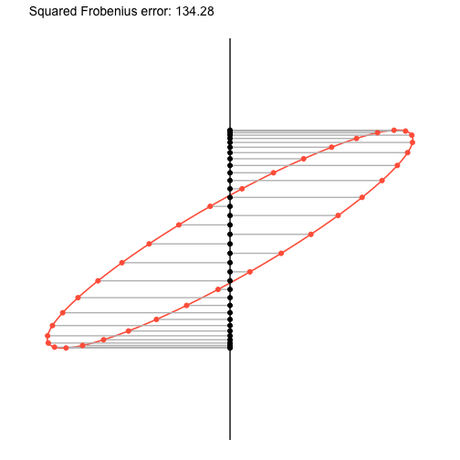
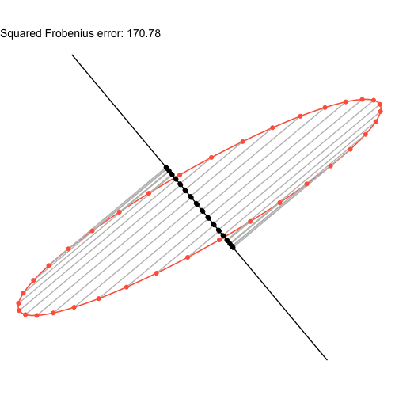
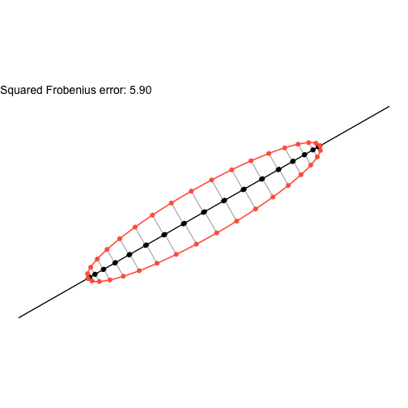

## PCA as a low-rank approximation

There's probably a lot of posts like this one on the internet and this won't be the best one. But it'll be the one I wrote, so it'll be the one I understand the most. This is also going to be very heuristic and for me to understand, not necessarily exactly accurate.

---

Most of the context I interact with PCA is in comparison to factor analysis methods. There's a lot of discussion about how (or if) these methods are different, but they definitely produce different results.
However, at the core of these two methods, there is a similar goal: reduce the dimensionality of your data to a few explanatory "factors" which explain most of the variation in the data. 
Although this is a tool thats predominately used in data realted problems, I would like to try to understand it without thinking about randomness at all.

---

Suppose we have a $$n$$ vectors $$X_1,\ldots, X_n\in\mathbb{R}^p$$. I'll assume they're centered, so that each column has mean 0. We stack up all these vectors as rows of a matrix

$$
\begin{align*}
 	\mathbf{X} = \begin{pmatrix}X_1^\top&\vdots&X_n^\top)\end{pmatrix}\in\mathbb{R}^{n\times p}.
\end{align*}
$$
 
Let's assume that $$p>>n$$, that is, our matrix is short and fat. We have a lot more dimensionality than data. It's probably the case that some of the "dimensionality" is redundant. 
This is related to the *rank* of the matrix. The rank of $$\mathbf{X}$$ is bounded by $$\text{min}(n,p)=n$$ (actually I think it's $$n-1$$ after centering), so there is definitely a subspace much smaller than $$\mathbb{R}^p$$ that contains all the rows $$X_1,\ldots, X_n$$.
Ideally, we would like to find a matrix which has *low rank* which is very similar to the original matrix $$\mathbf{X}$$. 
But, in what way do we want them to be similar? 
A natural idea would be to calculate the Euclidean norm of each of the row vectors $$X_i$$, and then just add their squares up. This norm has a name, the **Frobenius norm**, denoted by $$\|\cdot\|_{F}$$. Specifically,

$$
\begin{align*}
	\|\mathbf{X}\|_{F} = \sqrt{\sum_{i=1}^n \|X_i\|_2^2}.
\end{align*}
$$

Since this is a norm, it induces a metric, which provides a way to compute the "similarity" between two matrices. Recall we want a matrix of low rank which is "close" to the original matrix. We can write this down as a restricted optimization problem.

For some $$q < n$$ (hopefully $$\ll n$$), we would like to solve

$$
\begin{align*}
    \min_{\hat{\mathbf{X}}: \text{rank}(\hat{\mathbf{X}}) \le q} \|\mathbf{X}-\hat{\mathbf{X}}\|_F^2.
\end{align*}
$$ 

The Eckart–Young theorem applied to the Frobenius norm gives us the convenient result that this problem has an analytic solution in terms of the *singular value decomposition*. 
Basically, take the SVD of $$\mathbf{X} = \mathbf{U}\mathbf{\Lambda}\mathbf{V}^\top$$, with the singular values on the diagonal of $$\mathbf{\Lambda}$$ sorted from largest to smallest. Keep the $$q$$ largest, along with the first $$q$$ columns of $$\mathbf{U}$$ and $$\mathbf{V}$$ so that $$\mathbf{U}$$ is $$n\times q$$, $$\mathbf{V}$$ is $$q\times p$$, and $$\mathbf{\Lambda}$$ is $$q\times q$$. Then we got a rank-$$q$$ matrix that minimizes the squared Frobenius distance from $$\mathbf{X}$$. 

That's a pretty big jump, so let's slow down and try to develop some intuition for why that is true. 

Think about the matrix $\mathbf{X}$ as a linear transformation from $\mathbb{R}^p$ to $\mathbb{R}^n$. Since $$p\gg n$$ a huge part of $$\mathbb{R}^p$$ gets sent to 0. Whats left lives in $$\mathbb{R}^n$$. If you take the unit sphere in $$\mathbb{R}^p$$ and apply $$\mathbf{X}$$ to it, it's stretched and smushed into an ellipsoid with at most $$n$$ axes. The axes of this ellipsoid have lengths equal to the singular values of $$\mathbf{X}$$ (the diagonal entried of $$\mathbf{\Lambda}$$ and the points along the columns of $$\mathbf{U}$$. Usually, the axes tend to vary a lot. A few are very long and the rest are much shorter. 
When we look for a rank-$$q$$ approximation, we're looking for the $$q$$-dimensional slice of that ellipsoid that captures as much stretching as possible. That optimal slice is *spanned* by the $$q$$ longest axes, which is why we truncate the SVD.

To see why the choice of slice matters, imagine a 3D sphere that gets linearlly transformed into an ellipsoid, and then we wanna project is to the real line (get a rank-1 approximation). If we project it onto, say, the $$z$$-axis without thinking, we could miss most of the variation whenever the ellipsoid is mainly stretched along the $$x$$ and $$y$$ directions.

The next part is a toy version of the setup we have been talking about. Instead of $$p>>n$$, we will just have $$p=2$$ dimensions so we can look at it.
We will use $$A$$, a 2x2 matrix, as the linear map that stretched the unit circle into an ellipse. To get $$\mathbf{X}$$, I'll place 36 points on the circle (every 10 degrees), apply $$A$$ to each of them, and stack the results in a 36x2 matrix. I'll calculate the squared Frobenius error on some "bad" projections of these points and compare it to PCA.


``` r
library(ggplot2)

t <- seq(0, 2 * pi, length.out = 100)
circle <- rbind(cos(t), sin(t))
t.p <- seq(0, 2 * pi, length.out = 37)[-37]
circle.p <- rbind(x = cos(t.p), y = sin(t.p))

A <- matrix(c(2.5, 1.1,
              1.1, 1.2), nrow = 2, byrow = TRUE)

ellipse <- A %*% circle
ellipse.pt <- A %*% circle.p

df.l <- rbind(
  data.frame(x = circle[1, ],  y = circle[2, ], shape = "before"),
  data.frame(x = ellipse[1, ], y = ellipse[2, ], shape = "after")
)

df.p <- rbind(
  data.frame(x = circle.p[1,], y= circle.p[2,], shape = "before"),
  data.frame(x = ellipse.pt[1,], y=ellipse.pt[2,], shape = "after")
)

ggplot() +
  geom_path(data = df.l, aes(x=x,y=y,color=shape), linewidth = 0.75) +
  geom_point(data = df.p, aes(x=x,y=y, color=shape)) +
  coord_equal() +
  theme_void(base_size = 14) +
  theme(panel.grid = element_blank(),
	legend.title = element_blank())
```



---

Above we can see the unit circle and what $$A$$ does to it. If we naively project the ellipse onto either the $$x$$ or $$y$$ axis, we miss some of the variation. This is the equivalent of feature selection, or just using the single variable that explains the most variation.


``` r
Pts <- t(ellipse.pt)

# projection onto the y axis
X_hat <- cbind(rep(0, nrow(Pts)), Pts[, 2])

frobenius_sq <- sum((Pts - X_hat)^2)

df1 <- data.frame(x = Pts[, 1], y = Pts[, 2])
df2 <- data.frame(x = X_hat[, 1], y = X_hat[, 2])
df3 <- data.frame(x = Pts[, 1], y = Pts[, 2], 
                  xend = X_hat[, 1], yend = X_hat[, 2])

ggplot() +
  geom_path(data = subset(df.l,shape=="after"), aes(x=x,y=y), color='tomato', linewidth = 0.75) +
  geom_segment(aes(x = 0, y = -3, xend = 0, yend = 3)) +
  geom_segment(data = df3, aes(x = x, y = y, xend = xend, yend = yend), color='grey') +
  geom_point(data = df2, aes(x = x, y = y)) +
  geom_point(data = df1, aes(x = x, y = y), color = 'tomato') +
  coord_equal() +
  theme_void(base_size = 14) +
  theme(panel.grid = element_blank())+
  labs(subtitle = sprintf("Squared Frobenius error: %.2f", frobenius_sq))
```


---

Each grey line is the gap between a point and its projection. If we add up the squared lengths of all the grey lines, we get the squared Frobenius distance between the original points and their projections, which is the number I wrote on the plot. Even worse (or better) may be a random projection! For example:


``` r
# random projection!
u <- rnorm(2)
u <- u / sqrt(sum(u^2))

X_hat <- (Pts %*% u) %*% t(u)

frobenius_sq <- sum((Pts - X_hat)^2)

df1 <- data.frame(x = Pts[, 1], y = Pts[, 2])
df2 <- data.frame(x = X_hat[, 1], y = X_hat[, 2])
df3 <- data.frame(x = Pts[, 1], y = Pts[, 2],
                  xend = X_hat[, 1], yend = X_hat[, 2])

ggplot() +
  geom_path(data = subset(df.l,shape=="after"), aes(x=x,y=y), color='tomato', linewidth = 0.75) +
  geom_segment(aes(x = -3 * u[1], y = -3 * u[2], xend = 3 * u[1], yend = 3 * u[2])) +
  geom_segment(data = df3, aes(x = x, y = y, xend = xend, yend = yend), color='grey') +
  geom_point(data = df2, aes(x = x, y = y)) +
  geom_point(data = df1, aes(x = x, y = y), color = 'tomato') +
  coord_equal() +
  theme_void(base_size = 14) +
  theme(panel.grid = element_blank()) +
  labs(subtitle = sprintf("Squared Frobenius error: %.2f", frobenius_sq))
```


---

Finally, we show the optimal rank 1 projection of the ellipse. Note that this is obtained by doing PCA on $$\mathbf{X}$$! 


``` r
# here we get the first pc by svd, this is a rank 1 approximation of X
pc1 <- svd(Pts)$v[,1]

# and project
X_hat <- (Pts %*% pc1) %*% t(pc1)

frobenius_sq <- sum((Pts - X_hat)^2)
  
df1 <- data.frame(x = Pts[, 1], y = Pts[, 2])
df2 <- data.frame(x = X_hat[, 1], y = X_hat[, 2])
df3 <- data.frame(x = Pts[, 1], y = Pts[, 2],
                  xend = X_hat[, 1], yend = X_hat[, 2])
  
ggplot() +
  geom_path(data = subset(df.l,shape=="after"), aes(x=x,y=y), color='tomato', linewidth = 0.75) +
  geom_segment(aes(x = -5 * pc1[1], y = -5 * pc1[2], xend = 5 * pc1[1], yend = 5 * pc1[2])) +
  geom_segment(data = df3, aes(x = x, y = y, xend = xend, yend = yend), color='grey') +
  geom_point(data = df2, aes(x = x, y = y)) +
  geom_point(data = df1, aes(x = x, y = y), color = 'tomato') +
  coord_equal() +   
  theme_void(base_size = 14) +
  theme(panel.grid = element_blank()) +
  labs(subtitle = sprintf("Squared Frobenius error: %.2f", frobenius_sq))
```


---

As we can see, this has much smaller Frobenius squared error, in fact, it's the smallest possible. 

---

This post definitely (d)evolved into something different than when I started, but I think the visualization ended up being useful to me.
Remember, the ellipse is just a visualization of what $$\mathbf{X}$$ does to the unit circle. The points on the circle are a stand-in for $$\mathbf{X}$$ itself, which is why projecting them onto the top singular direction gives the best possible rank-1 projection.
